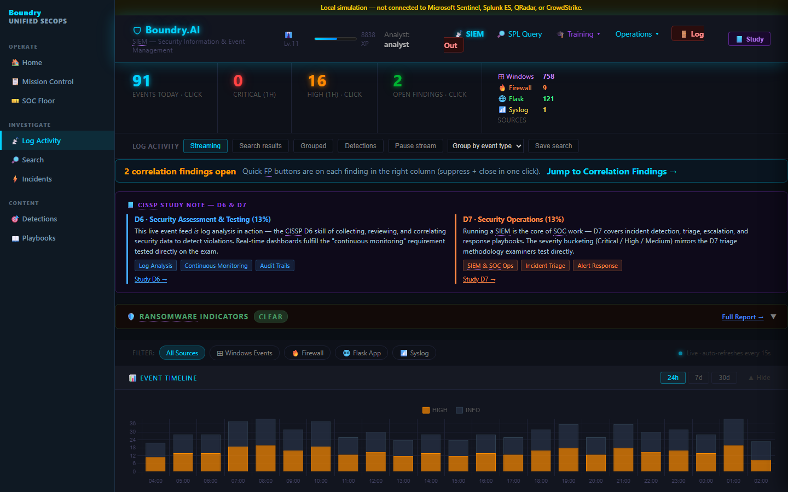
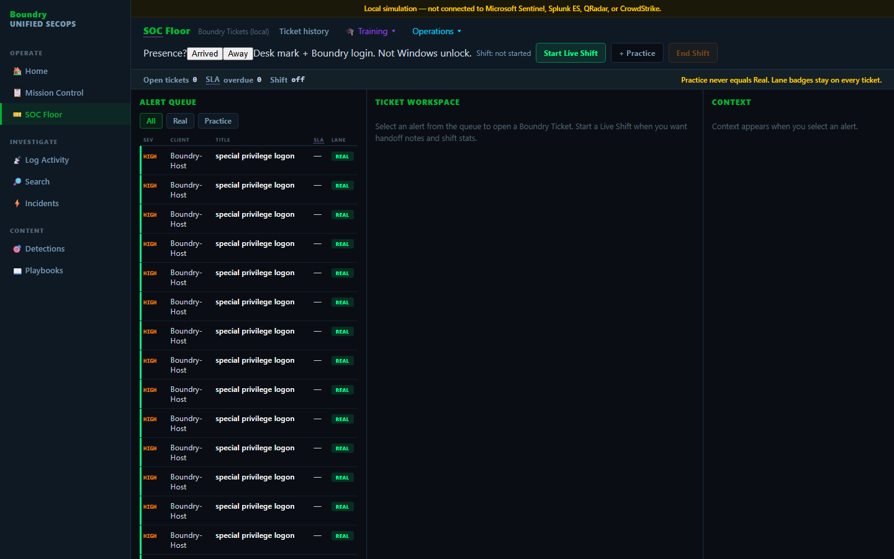
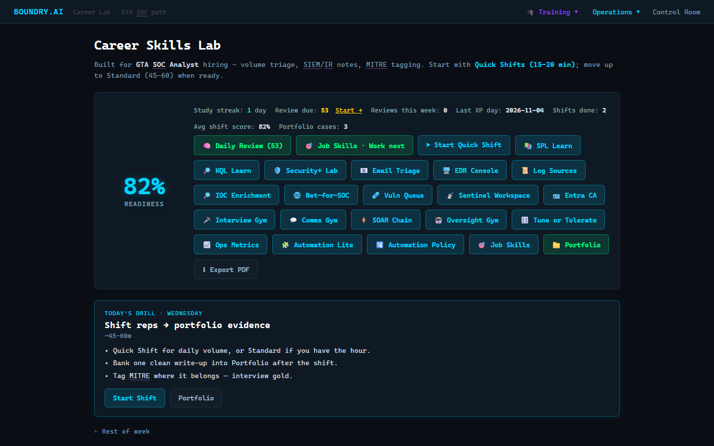
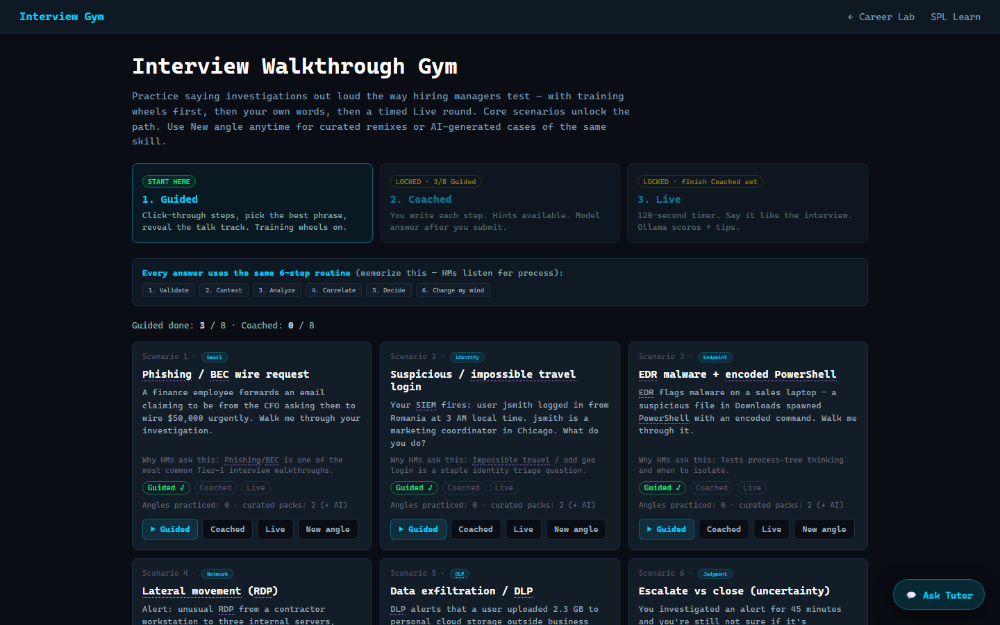

# Boundry.AI: SOC Operations + Career Training Platform

[](https://github.com/JsonCMorgan/boundry-ai-soc-platform/actions/workflows/ci.yml)


## Start here

I'm Jason (GTA). This repo is where I practice **SOC-style work** for real: alert triage, investigation notes, ticket hygiene, SIEM queries, incident reports, and drills when I'm not at the day job.

- **What it is:** my practice platform and Boundry build, not a shrink-wrapped vendor product
- **Peek first:** [screenshots](#a-quick-tour), then [docs/SECURITY.md](docs/SECURITY.md) for how I hardened it
- **Want the map?** [docs/PROJECT_STRUCTURE.md](docs/PROJECT_STRUCTURE.md) and [docs/PORTFOLIO_VERIFICATION_GUIDE.md](docs/PORTFOLIO_VERIFICATION_GUIDE.md) (how I'd walk someone through the repo)
- **Report a security issue:** [SECURITY.md](SECURITY.md)

[LinkedIn](https://www.linkedin.com/in/jason-morgan-110656289/) · [My other labs](https://github.com/JsonCMorgan)

---

So here's what Boundry.AI actually is. I'm building security tooling for the businesses everyone else writes off as too small to bother with: the clinics, the law firms, the small retailers. They handle sensitive data every single day, they're legally on the hook for it, and the enterprise security shops won't give them the time of day. I've always wanted to fight for the little guy.

My roots are in physical security. Almost ten years working the door at bars and venues. I earned my Cybersecurity certificate from York University in 2024 and I'm ISC² certified. A bouncer and a SOC analyst really do the same job. You read the room, you spot the problem before it becomes an incident, and you stay calm and move fast when it does.

---

## A quick tour

| SIEM live stream | SOC Floor (ticket queue) |
|---|---|
|  |  |
| **Career Skills Lab** | **Interview Gym** |
|  |  |

> **🗣️ Real Talk:** The SIEM is the metal detector. Every bit of activity walks through it and it goes off on the dangerous stuff. The SOC Floor is my clipboard at the door: every alert becomes a ticket with an SLA clock, a summary, and a next action. The Career Lab is where I run drills so I'm sharp before the real shift starts.

---

## What's inside

### Security operations

| Module | What it does |
|--------|-------------|
| **SIEM** | Live event feed from Windows Event Log, firewall log, syslog, and app events. Severity buckets, filters, correlation rules that raise findings automatically |
| **SPL-lite query engine** | Splunk-style queries (`severity=HIGH \| stats count by src_ip \| sort -count`) translated safely to SQL with a column allow-list |
| **SOC Floor + tickets** | MSSP-style case console: multi-client queue, SLA timers, ticket numbers, investigation tasks, dispositions |
| **SOAR** | Approval-gated playbook actions (enrich, contain, notify) with a human in the loop |
| **MITRE ATT&CK** | Findings mapped to techniques with detection and response guidance |
| **IR playbooks** | Ransomware, phishing/BEC, data breach, account compromise, insider threat. YAML for machines, plain language for business owners |
| **Reports + PDF** | AI-drafted incident reports (local Ollama first), branded PDF export |

### Career Skills Lab (SOC Tier 1 training)

Built to close the gap between "I passed a cert" and "I can work a queue on day one." Every track follows **Show me → Help me → Prove it**.

| Track | Skill it trains |
|-------|-----------------|
| Security+ Lab | Original micro-lessons for all 5 domains, PBQ-style drills, spaced review |
| Email Triage | Header analysis, SPF/DKIM/DMARC, phishing dispositions |
| EDR Console | Process trees, isolate vs. monitor, false-positive calls |
| Log Sources | Windows 4625/4688, firewall, proxy, M365 evidence drills |
| KQL + SPL Learn | Query fluency for Sentinel and Splunk |
| Sentinel Workspace + Entra CA | Incidents, entities, hunting blades, Conditional Access outcomes |
| IOC Enrichment, Vuln Queue, Net-for-SOC | Enrich before escalating, CVSS vs. exploitability vs. asset value, ports/DNS/HTTP signals |
| Interview Gym | Guided, coached, and live walkthroughs of real interview scenarios |
| Comms, Oversight, Tune, Metrics, Automation | Stakeholder updates, reviewing AI verdicts, tuning noisy rules, MTTD/MTTR, automation policy |

> **🗣️ Real Talk:** I don't want to read about bar fights and call it training. This is my sparring gym. Every drill is a situation I expect on a real SOC shift, and every case I work can turn into a portfolio PDF when I need one.

---

## Security and data isolation

Boundry.AI started as a **deliberately vulnerable app** and I hardened it piece by piece. The `vulnerable` branch keeps the original exploitable code for practice. Full write-up with the tests that prove each fix: **[docs/SECURITY.md](docs/SECURITY.md)**.

- Session auth with **bcrypt** hashing and optional **TOTP 2FA**
- **CSRF** protection on every state-changing form
- **Adjustable login throttle** (Normal / Elevated / Lockdown) with every throttled attempt logged to the SIEM
- **Per-client isolation:** client queries are scoped by `owner_id`; client and demo accounts get a 404 on every ops route
- **Parameterised SQL everywhere** (no string-built queries on `main`)
- **CI on every push:** gitleaks secrets scan, ruff lint gate, and the pytest suite

> **🗣️ Real Talk:** A security company with a leaky platform is a bouncer who leaves the back door propped open. Every client sits behind their own locked door, and the CI pipeline is the guard who checks every delivery before it comes in.

---

## Tech stack

| Layer | Technology |
|-------|-----------|
| Backend | Python 3.11 · Flask |
| Database | PostgreSQL (Railway) · SQLite (local), raw parameterised SQL, no ORM |
| Auth | Sessions · bcrypt · PyOTP (TOTP 2FA) · Flask-WTF CSRF · Flask-Limiter |
| AI | **Local Ollama first** (llama3.1:8b), Anthropic fallback only when local is unavailable |
| Frontend | Jinja2 · vanilla JS · CSS custom properties |
| CI | GitHub Actions · gitleaks · ruff · pytest |
| Deploy | Railway · Gunicorn |

## Architecture

```
   Client website / app          Windows Event · Firewall · Syslog
            │ (X-API-Key)                    │ (collectors)
            ▼                                ▼
   ┌──────────────────┐            ┌──────────────────┐
   │   /api/ingest    │──────────▶ │   SIEM event     │
   │ tagged owner_id  │            │   store + rules  │
   └──────────────────┘            └────────┬─────────┘
                                            │ correlation
               ┌────────────────────────────┼─────────────────────┐
               ▼                            ▼                     ▼
        SOC Floor tickets           SOAR (human gate)      AI triage (Ollama)
               │                                                  │
               └──────────────▶ Incident reports + PDF ◀──────────┘
```

> **🗣️ Real Talk:** Follow the arrows. Events come in the front door, get tagged to the right client, walk through the metal detector, and anything suspicious becomes a ticket I work and a report the client can read.

---

## Run it locally

```bash
git clone https://github.com/JsonCMorgan/boundry-ai-soc-platform.git
cd boundry-ai-soc-platform
pip install -r requirements-dev.txt

python -m pytest -q        # run the test suite
python app.py              # http://localhost:5000
```

The SQLite database builds itself on first run. Secrets (API keys, `SECRET_KEY`) are passed in as environment variables and are never committed. In production on Railway, set `SECRET_KEY`, `DATABASE_URL`, `ANTHROPIC_API_KEY`, `RESEND_API_KEY`, `APP_URL`, and `CRON_SECRET`.

## Roles

| Role | Access |
|------|--------|
| `analyst` | Full platform: SIEM, SPL, SOC Floor, training, all client reports |
| `client` | Their own reports portal, nothing else |
| `demo` | Sealed sandbox with fake data only |

## GitHub and portfolio upkeep

I keep notes here on how I maintain the public repos tied to this build:

| Doc | Use |
|-----|-----|
| [docs/GITHUB_INDUSTRY_AUDIT.md](docs/GITHUB_INDUSTRY_AUDIT.md) | Full rubric, scores, and 30/60/90 remediation |
| [docs/PORTFOLIO_VERIFICATION_GUIDE.md](docs/PORTFOLIO_VERIFICATION_GUIDE.md) | How I'd walk through this repo in two minutes |
| [docs/GITHUB_AUDIT_QUARTERLY_CHECKLIST.md](docs/GITHUB_AUDIT_QUARTERLY_CHECKLIST.md) | Monthly re-audit checklist |

## Live today vs. roadmap

- ✅ **App security monitoring.** A client drops a snippet into their site and failed logins, injection attempts, and username probing flow into the SIEM as tagged events.
- 🚧 **Full infrastructure monitoring.** A lightweight log-shipping agent for servers and networks. Parked until real clients ask for it.

> **🗣️ Real Talk:** I'd rather promise small and deliver big than the other way around.
